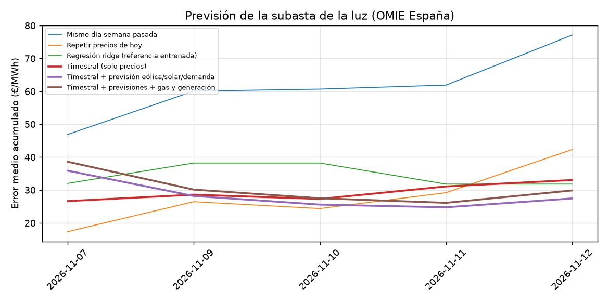

# timestral-luz

Prueba en vivo durante un mes: ¿acierta [Timestral](https://huggingface.co/mistralai/Timestral-209M), el modelo de series temporales de Mistral, el precio de la luz en España antes de la subasta?

Cada mañana, antes de la subasta del mercado diario de OMIE (12:00, hora peninsular), un GitHub Action predice los 24 precios horarios del día siguiente y **los guarda en el repositorio**. El commit lleva fecha y hora, así que queda demostrado que la previsión se hizo antes de conocer el resultado. Por la tarde, cuando OMIE ya ha publicado el resultado, otro Action compara la previsión con el precio real y actualiza este marcador.

## Marcador

<!-- SCOREBOARD:START -->
**Días puntuados:** 5 (del 2026-11-07 al 2026-11-12). Precio medio real en el periodo: 184.9 €/MWh.

|                                            |   Error medio (€/MWh) |   RMSE |   Sesgo |   Batería: % de lo ideal |   Cobertura 80% |   Días que gana |
|:-------------------------------------------|----------------------:|-------:|--------:|-------------------------:|----------------:|----------------:|
| Timestral + previsión eólica/solar/demanda |                 27.45 |  34.57 |    3.3  |                    82.43 |            0.82 |               2 |
| Timestral + previsiones + gas y generación |                 29.88 |  37.74 |    3.92 |                    82.43 |            0.79 |               0 |
| Regresión ridge (referencia entrenada)     |                 31.81 |  42.34 |  -19.34 |                    88.79 |          nan    |               1 |
| Timestral (solo precios)                   |                 33.05 |  43.18 |    5.24 |                    85.57 |            0.75 |               0 |
| Repetir precios de hoy                     |                 42.31 |  55.2  |   19.99 |                    31.85 |          nan    |               2 |
| Mismo día semana pasada                    |                 77.1  |  87.2  |   34.69 |                    83    |          nan    |               0 |


<!-- SCOREBOARD:END -->

**Cómo leerlo**
- **Error medio:** cuántos €/MWh se equivoca de media en cada hora. Cuanto más bajo, mejor.
- **Sesgo:** si tiende a pasarse (positivo) o a quedarse corto (negativo).
- **Batería:** una batería de 1 MWh que carga en las 4 horas más baratas según la previsión y descarga en las 4 más caras posteriores, con un 88 % de eficiencia. Indica qué parte del beneficio máximo posible (sabiendo los precios de antemano) se habría conseguido.
- **Cobertura 80 %:** el porcentaje de horas en que el precio real cae dentro del rango del 80 % que da Timestral. Lo ideal es 0,80.
- Solo cuentan los días en que la previsión se guardó antes de que OMIE publicara el resultado (`valid`).

## Qué compite

| Modelo | Qué usa |
|---|---|
| Timestral (solo precios) | Las últimas 8 semanas de precios horarios |
| Timestral + previsiones | Lo anterior, más la previsión de demanda en España (Energy-Charts) y la previsión meteorológica de Open-Meteo: viento a 100 m en zonas eólicas, radiación solar en zonas fotovoltaicas y temperatura en grandes ciudades |
| Timestral + todo | Lo anterior, más el precio del gas (MIBGAS) y la generación real de gas, hidráulica, nuclear e intercambios con otros países |
| Regresión ridge | Un modelo clásico entrenado cada día con el último año: precios anteriores, previsión de demanda, previsión meteorológica y gas. Es la referencia que haría cualquier analista |
| Repetir precios de hoy | Supone que mañana será igual que hoy |
| Mismo día semana pasada | Copia el mismo día de la semana anterior |

Timestral no se entrena: se usa tal cual sale de Hugging Face.

## Datos (todos públicos)
- [OMIE](https://www.omie.es): precio marginal del mercado diario en España.
- [Energy-Charts](https://energy-charts.info) (Fraunhofer ISE): generación por tecnología y previsión del día siguiente de eólica, solar y demanda.
- [MIBGAS](https://www.mibgas.es): índice diario del gas en el punto virtual de balance (PVB).
- [Open-Meteo](https://open-meteo.com): previsión meteorológica. Energy-Charts publica su previsión de eólica y solar demasiado tarde para usarla antes de la subasta, así que se sustituye por viento y radiación previstos.

## Prueba previa (antes de empezar en vivo)
Se simuló un año (noviembre 2025–noviembre 2026), prediciendo cada día solo con información disponible antes de la subasta. Los resultados están en `results/backtest.json`.

## Archivos
- `forecasts/AAAA-MM-DD.csv`: previsión de cada modelo para ese día (p10, p50 y p90 por hora), junto a un `.json` con la hora a la que se hizo.
- `results/actuals/`: precios reales de OMIE.
- `results/daily_scores.csv`: puntuación de cada día y modelo.

## Ejecutarlo a mano
```bash
pip install -r requirements.txt
python src/forecast.py            # previsión de mañana
python src/score.py               # puntuar lo que ya tenga resultado
```
En GitHub: Actions → «previsión diaria» → Run workflow.
